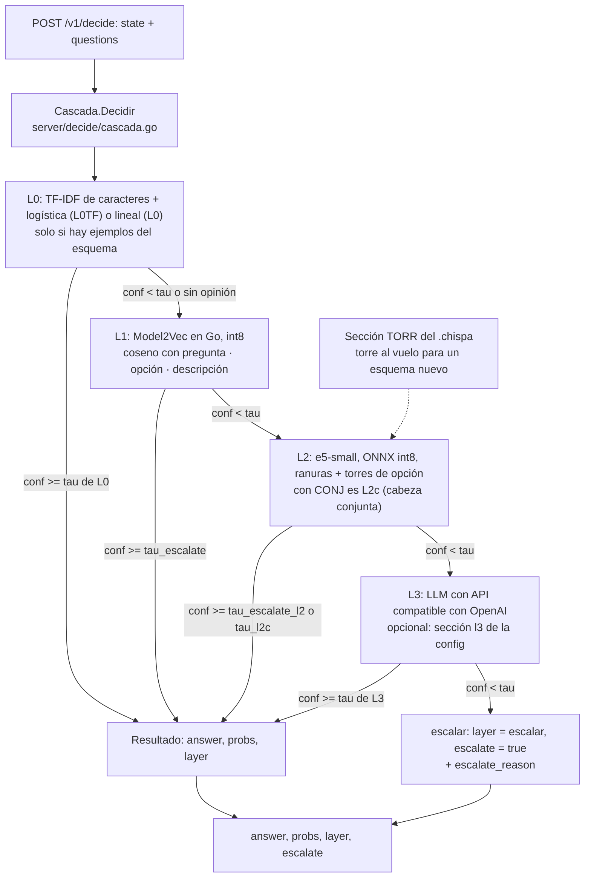
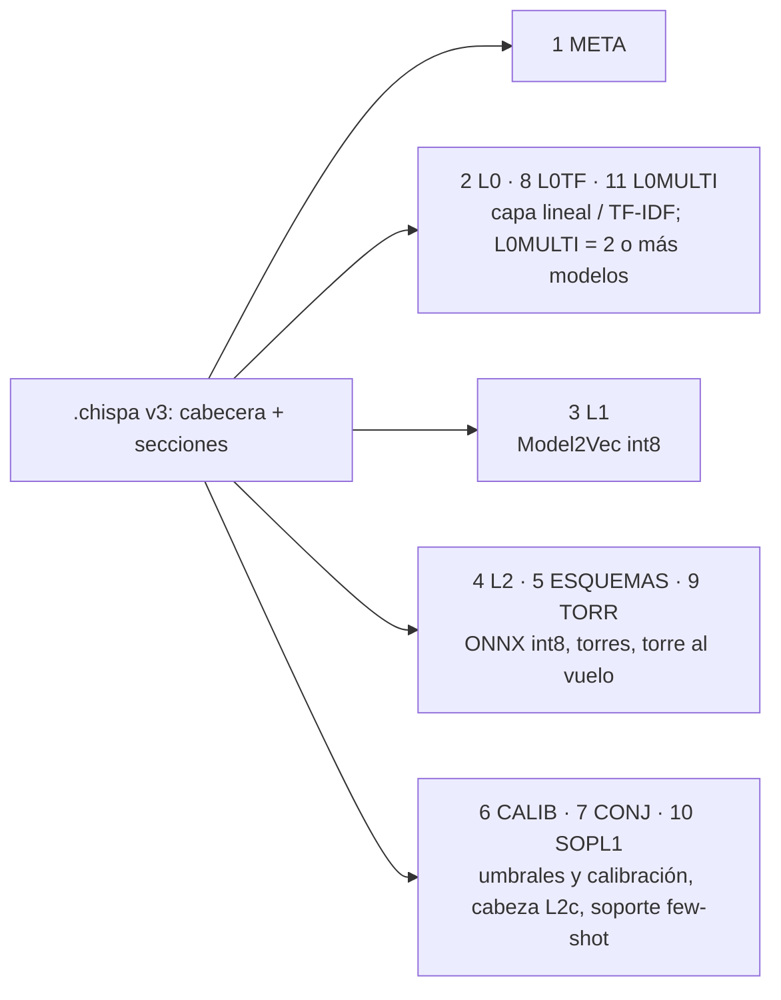
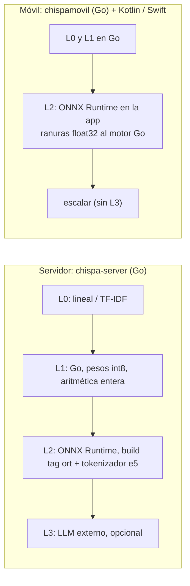
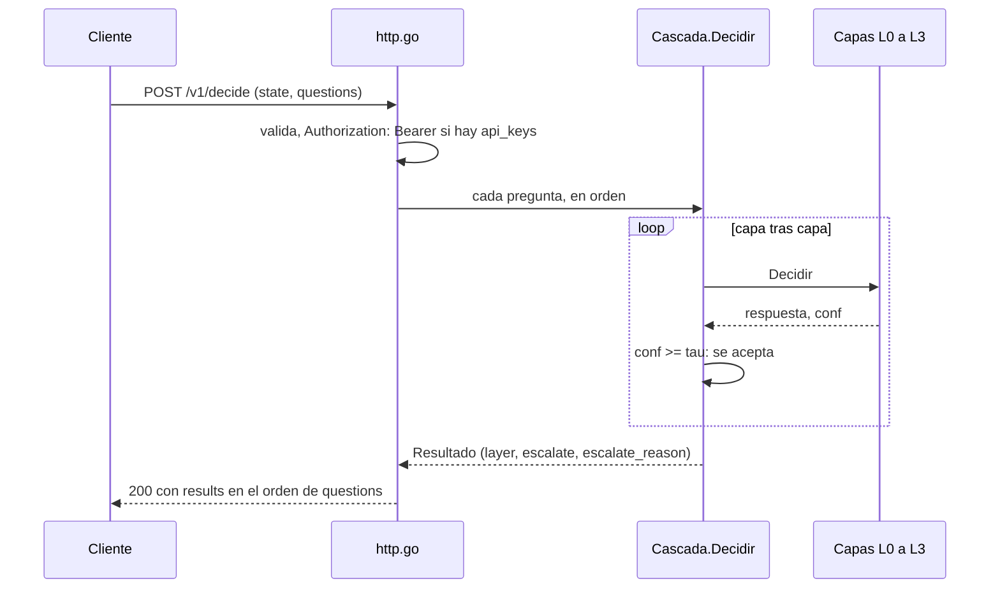

# Chispa

Clasificador tipado, de bajo coste y de propósito general, open source (Apache-2.0), en la línea de Jev o Laya. Tú mandas un texto y una
pregunta con sus opciones; Chispa devuelve la opción elegida, una probabilidad por opción y la capa que contestó. Decide sobre
esquemas que no ha visto (zero-shot) o con pocos ejemplos, en CPU y sin GPU: en servidor, en ARM y en el móvil.
massive, clinc150, hatecheck, spam e injection son **benchmarks**, no el objetivo del producto.

Si ninguna capa llega a su umbral, Chispa **no inventa**: escala (`"layer": "escalar"`) y te da su mejor pista.

## Tipos de pregunta

Valores de `kind` que acepta hoy `server/` ([`server/decide/types.go`](server/decide/types.go), [`docs/03-api.md`](docs/03-api.md)):

| `kind` | Qué pregunta es | Respuesta |
|---|---|---|
| `choice` | Elegir una opción (2 a 256) | el `id` elegido |
| `noul` | Sí o no | `"true"` o `"false"` |
| `score` | Nivel ordinal, ids `"1"` … `"K"` | `"1"` … `"K"` |
| `multi` | Multietiqueta: varias opciones a la vez, o ninguna | `answers`: la lista de activas |

## Cómo usarlo

### Servidor Go: `POST /v1/decide`

```sh
cd server && go build -o chispa-server ./cmd/chispa-server
./chispa-server -addr 127.0.0.1:8090 -modelo ../ferreteria.chispa   # el .chispa lo escribe `chispa train`
```

```sh
curl -s localhost:8090/v1/decide -d '{"state":"Mensaje urgente: no me ha llegado el pedido y lo necesito hoy",
 "questions":[{"id":"u1","question":"¿Qué tan urgente es?","kind":"choice",
   "options":[{"id":"alta","description":"Requiere atención inmediata"},{"id":"baja","description":"Puede esperar"}],"nonce":"abc-1"}]}'
```

Respuesta (la forma; los valores cambian con el modelo; ejemplo real en [`choice.resp.json`](server/decide/testdata/choice.resp.json)):

```json
{"results": [
  {"id": "u1", "kind": "choice", "answer": "alta", "probs": {"alta": 0.9, "baja": 0.1},
   "layer": "L0", "escalate": false, "ms": 0, "nonce": "abc-1"}
]}
```

Si escala: `"escalate": true`, `"layer": "escalar"` y `escalate_reason` (`baja_confianza`, `sin_opinion`, `score_ids_no_validos`,
`sin_presupuesto_torres`, `incompleta`). Contrato formal: [`server/api/openapi.yaml`](server/api/openapi.yaml).
Rutas: `/v1/decide`, `/healthz`, `/metrics`.

### SDK

| SDK | Léelo en |
|---|---|
| Python (`chispa train`, cliente) | [`sdk/python/README.md`](sdk/python/README.md) |
| JavaScript (Node ≥ 20 y navegador) | [`sdk/js/README.md`](sdk/js/README.md) |
| Go (cliente HTTP) | [`sdk/go/README.md`](sdk/go/README.md) |
| Android (Kotlin) | [`sdk/android/README.md`](sdk/android/README.md) |
| iOS (Swift, sin compilar) | [`sdk/ios/README.md`](sdk/ios/README.md) |
| Motor móvil Go (`gomobile`) | [`sdk/movil/README.md`](sdk/movil/README.md) |

Índice de todos: [`sdk/README.md`](sdk/README.md). Los paquetes no se han publicado en ningún registro: se usan desde el repositorio.

Documentación: [`docs/00-indice.md`](docs/00-indice.md) · [qué es](docs/01-que-es.md) · [inicio rápido](docs/02-inicio-rapido.md) ·
[API](docs/03-api.md) · [formato `.chispa`](docs/04-formato-chispa.md) · [rendimiento y límites](docs/07-rendimiento-y-limites.md).

## Tres modos

| Modo | Qué necesitas | Estado |
|---|---|---|
| Zero-shot | El esquema, con descripciones | Flojo; escala mucho (ver abajo) |
| Few-shot | Pocos ejemplos por opción | L1 sube de 0,45 a 0,65 de macro-F1 con 32 ejemplos por clase |
| **Con datos del cliente** (`chispa train --conjunta`: L0TF + L2c) | ≥ 20 ejemplos por opción | **El que funciona** |

## Estado real, con cifras

Cada cifra sale del fichero enlazado. Una sola corrida y una sola semilla salvo que se diga otra cosa. Lo que no se midió se
dice en [`docs/07`](docs/07-rendimiento-y-limites.md#qué-no-se-midió).

**Con datos del cliente (el modo que funciona).** Macro-F1 por `/v1/decide` con la cascada de producción
([`e2e-20261028/LEEME.md`](server/deploy/resultados/e2e-20261028/LEEME.md)):

| tarea | macro-F1 por `/v1/decide` |
|---|---|
| massive | 0,814 |
| clinc150 | 0,887 |

Latencia en esa corrida (c6a.xlarge, 1 cliente, misma fuente): p99 de 9–12 ms por consulta; L0 responde el 54–67 % de las consultas.
Sin ejemplos propios esas cifras no valen. Con tu tarea: sin medir (piloto en Colombia sin medir,
[`pilotos/metrica.md`](pilotos/metrica.md)).

**Zero-shot: no vende hoy.**
- L1 con potion: macro-F1 medio de 0,455 en 5 tareas; 0,406 en massive y 0,445 en clinc150
  ([`model/l1/resultados/2026-10-28/informe.md`](model/l1/resultados/2026-10-28/informe.md)).
- Con L2 solo y un τ elegido en validación, solo spam cumple «escalada ≤ 30 % con precisión ≥ 0,85» (0 % de escalada, precisión 0,926).
  clinc150 escala el 11,0 % pero con precisión 0,777; massive, hatecheck e inyecciones escalan entre el 78 % y el 100 %
  ([`model/bench/tau/resultados-20261103/LEEME.md`](model/bench/tau/resultados-20261103/LEEME.md)). Con el τ de 0,93 anterior, escalaba del 98 % al 100 %.
- **«Chispa: Caída»** (demo, servidor local sin GPU): con `--decidir tau` todas las preguntas nuevas escalan (escudo 100 %) y Chispa no
  decide ninguna jugada; con `--decidir argmax` coincide con el profesor en el 28,2 % de las jugadas, todas bajo τ
  ([`model/bench/caida/resultados-20261102/LEEME.md`](model/bench/caida/resultados-20261102/LEEME.md)).

**L3 (LLM local), solo como respaldo asíncrono.** Con Ollama y `qwen3:4b-instruct` en un i7 de 4 núcleos, sobre 1 061 filas
(massive-es, 700, y hatecheck-es, 361): la cascada sin L3 escalaba el 37,0 %. En hatecheck (sí/no) L3 contesta en todas las escaladas y
la cascada pasa del 28,8 % al 48,5 %, a unos 4 s por escalada; en massive (60 opciones) casi nunca supera su τ y apenas cambia (43,6 → 44,0 %).
Sus probabilidades son autodeclaradas, no calibradas
([`model/bench/l3/resultados-20261103/LEEME.md`](model/bench/l3/resultados-20261103/LEEME.md)).

**Abstención y robustez.** Con el τ de `CALIB` anterior a T4.6b, la cascada escalaba el 46 % en clinc150 y el 43 % en massive, con precisión de
0,984 y 0,969 en lo contestado ([`abstencion-20261028/LEEME.md`](server/deploy/resultados/abstencion-20261028/LEEME.md)). No hay medida de la
abstención con el τ actual: mídela con tus datos. ASR de 0,021 en injection y spam, en parte porque el detector escala el 47 % y el 83 % de los ataques
([`arena-20261028/LEEME.md`](server/deploy/resultados/arena-20261028/LEEME.md)).

**Latencia en CPU para esquemas nuevos.** Servidor fp32 en un i7 de 4 núcleos, petición de 3 preguntas: p50 de 290 ms con la caché de torres fría y de 58 ms caliente
(≈ 13 ms por torre e5) ([`model/bench/caida/resultados-20261102/LEEME.md`](model/bench/caida/resultados-20261102/LEEME.md)).

Sin medir (ver [`docs/07`](docs/07-rendimiento-y-limites.md#qué-no-se-midió)): calidad de L2 con torre al vuelo en tareas no vistas, latencia en
dispositivo Android/iOS, tareas colombianas reales y el tamaño de la imagen OCI.

## Cómo decide por dentro

Todo lo de esta sección sale del código; cada nodo lleva su fichero.



Reglas de la cascada, en [`server/decide/cascada.go`](server/decide/cascada.go) (`Cascada.Decidir`):

- Se prueba cada capa en orden; la respuesta se acepta si `conf > 0` y `conf >= τ` de esa capa. Una capa sin modelo o con error cuenta como confianza 0.
- Orden de las capas en el servidor: L0, L1, L2, L3 ([`server/cmd/chispa-server/main.go`](server/cmd/chispa-server/main.go)).
- τ por defecto: L0 0,80, L1 0,80, L2 0,70 y L3 0,60 ([`config.go`](server/decide/config.go), `ConfigPorDefecto`).
  Con `CALIB`, L1 usa `tau_escalate`; L2 usa `tau_escalate_l2` (si falta, `tau_escalate`) y, si el `.chispa` trae `tau_l2c`, la cabeza
  L2c usa ese y deja `tau_escalate_l2` como respaldo; para un esquema que no estaba en `ESQUEMAS`, `tau_l2_esquema_nuevo`
  ([`modelo.go`](server/decide/modelo.go), [`cascada.go`](server/decide/cascada.go), [`format/chispa3/secciones.go`](format/chispa3/secciones.go) `Calib`).
- `CALIB.tipos` (y `tipos_l2`) guarda por tipo (`choice`, `noul`, `scoreK`, …) los parámetros de calibración `T`, `a`, `b` y `theta`.
- `escalate_reason`: `baja_confianza`, `sin_opinion`, `score_ids_no_validos`, `sin_presupuesto_torres`, `incompleta` (`cascada.go`).
- **L3 existe en el servidor** ([`server/decide/l3.go`](server/decide/l3.go)) pero está **apagada por defecto**: sin sección `l3` en la config es un stub
  sin opinión. **No existe en el motor móvil** ni en Kotlin/Swift (`sdk/android/README.md`, `sdk/movil/README.md`).
- `--decidir argmax|tau` **no es una opción del servidor**: es del agente de la demo [`demos/caida`](demos/caida/README.md). Con `tau` (defecto), si Chispa
  escala juega el profesor; con `argmax`, juega el argmax de `probs` aunque escale. El τ del servidor no se toca.

### Secciones del `.chispa` v3

Enum `Tipo` en [`format/chispa3/chispa3.go`](format/chispa3/chispa3.go) (detalle en [`docs/04`](docs/04-formato-chispa.md)):



### Servidor y móvil



Precisión, según el código y la documentación:

- **L1** (servidor y móvil): pesos int8 con escala float32 por fila y aritmética entera, idéntica en amd64 y arm64 ([`runtime/l1/embed.go`](runtime/l1/embed.go)).
- **L2**: el `.chispa` guarda el ONNX del codificador y las torres de opción en int8 ([`docs/04`](docs/04-formato-chispa.md)); el perfil de exportación se
  elige con `--perfil servidor|movil|movil-int8`: `servidor` es fp32, `movil` es fp16 con vocabulario podado, `movil-int8` es int8 dinámico ([`docs/02`](docs/02-inicio-rapido.md)).
  Las ranuras que salen de ORT son float32 ([`sdk/movil/README.md`](sdk/movil/README.md)).
- La cascada del móvil vive en Kotlin ([`Cascada.kt`](sdk/android/chispa/src/main/kotlin/com/chispa/sdk/Cascada.kt)) y Swift; el motor Go no lleva ONNX Runtime.

### Flujo de una petición



## Mapa del repositorio

- [`docs/`](docs/00-indice.md): documentación de producto.
- [`format/chispa3/`](format/chispa3/README.md): el formato `.chispa` v3 y su cargador en Go.
- [`server/`](server/README.md): `chispa-server` (`/v1/decide`, `/healthz`, `/metrics`); `decide/` (cascada y capas), `torre/` ([README](server/torre/README.md)),
  `api/` (OpenAPI), `carga/`, `deploy/`, `cmd/`.
- `runtime/`: `l1/` (Model2Vec en Go int8) y `tok/` (tokenizador de e5 en Go).
- `model/`: entrenamiento, L2, datos, líneas base e informes de las fases.
- [`sdk/`](sdk/README.md): Python, JS, Go, Android, iOS y el motor móvil Go.
- [`demos/caida`](demos/caida/README.md) y [`demo/wasm`](demo/wasm/README.md): demos.
- [`pilotos/`](pilotos/README.md): kit de piloto para una empresa colombiana.
- [`audio/`](audio/README.md): diseño de Chispa de audio, sin modelos.
- [`arena/`](arena/README.md): banco de pruebas adversarial.
- [`deploy/kindling/`](deploy/kindling/README.md): imagen para una microVM.

Desde la raíz, `make test` y `make smoke` delegan en `arena/`.

## Licencia

Apache-2.0: [`LICENSE`](LICENSE). Las atribuciones de terceros están en [`NOTICE`](NOTICE). Los datasets con SA, NC o con términos pendientes
(XNLI, clima, datos.gov.co, SIB-200, etiquetas de ALIA, salidas de Haiku) no se redistribuyen y solo se usan como test.
